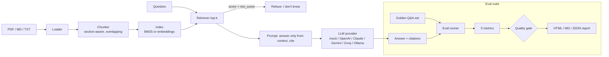

# 📚 RAG Eval Assistant

**Ask questions about your own documents and get answers that cite their sources, plus a built-in test suite that checks whether those answers can be trusted.**

Drop in PDFs, Markdown or text files (company policies, product docs, test plans) and ask questions in plain English. Every answer cites the file and section it came from. If the documents don't cover the question, the assistant says *"I don't know"* instead of guessing.

The part that sets it apart is the **evaluation suite**. A golden Q&A set and five quality metrics turn "the demo looked fine" into a **pass/fail quality gate** that runs in CI, the same way a regression suite protects a normal app.

## Why it's useful

- **Teams can trust the answers.** Citations let anyone check a claim against the source in seconds.
- **No confident nonsense.** Two guardrails produce refusals: weak retrieval stops the question before the LLM is called, and the prompt tells the model to refuse when the context doesn't cover it.
- **Changes are safe.** Swapped the model, chunk size or prompt? `python -m rag_eval eval` tells you if quality dropped, and CI blocks the merge.
- **Runs anywhere.** A deterministic offline `mock` LLM and BM25 retrieval mean the app, tests and evals work with **zero API keys**.

## Architecture



| Module | Job |
|---|---|
| `rag_eval/loaders.py` | Reads PDF (pypdf), Markdown, TXT |
| `rag_eval/chunking.py` | Splits text into ~600-character overlapping chunks and records the heading each came from |
| `rag_eval/retrieval.py` | BM25 (offline, default); sentence-transformers or OpenAI embeddings (optional) |
| `rag_eval/prompts.py` | Grounded system prompt + numbered context |
| `rag_eval/providers/` | `mock` (offline, deterministic), OpenAI, Anthropic, Gemini, Groq, Ollama |
| `rag_eval/pipeline.py` | `RAGAssistant.ask()`: retrieve → guardrail → generate → parse citations |
| `rag_eval/evaluation.py` | Metrics, quality gate, reports |
| `app.py` / `rag_eval/cli.py` / `api.py` | Streamlit UI, CLI, FastAPI |

## Quickstart

```bash
python -m venv .venv && source .venv/bin/activate
pip install -r requirements-dev.txt          # core + pytest (enough for CLI, tests, evals)

python -m rag_eval ask "How many days of annual leave do I get?"
python -m rag_eval ask                       # interactive chat
python -m rag_eval --docs ./my_docs ask "..."  # your own documents
python -m rag_eval eval                      # golden set + quality gate -> reports/
pytest -q
```

UI and API:

```bash
pip install -r requirements-app.txt
streamlit run app.py              # upload docs, ask, run evals in the browser
uvicorn api:app --reload          # POST /ask {"question": "..."}
docker build -t rag-eval . && docker run -p 8501:8501 rag-eval
```

### Use a real LLM

Copy `.env.example` to `.env`, then set for example:

```bash
LLM_PROVIDER=anthropic   # or openai | gemini | groq | ollama
ANTHROPIC_API_KEY=...
LLM_MODEL=               # optional; sensible default per provider
EMBEDDINGS=bm25          # or sentence-transformers | openai
```

Install only the SDK you need from `requirements-providers.txt`. Ollama needs no SDK.

## How the evals work

`evals/golden_set.yaml` holds 25 cases about the sample docs: 20 answerable questions, each with an expected source file and the key facts a correct answer must contain, plus 5 out-of-scope questions that must be refused.

| Metric | Question it answers | How it's measured |
|---|---|---|
| `retrieval_hit_rate` | Did we find the right document? | expected source is in the top-k chunks |
| `answer_correctness` | Is the answer right? | all required key facts appear in the answer |
| `groundedness` | Did it make anything up? | each answer sentence's words **and numbers** must appear in the retrieved text |
| `citation_accuracy` | Does it point to the right source? | the answer cites a chunk from the expected file |
| `refusal_accuracy` | Does it know when to say "I don't know"? | refuses out-of-scope questions, answers in-scope ones |

Minimums live in `evals/thresholds.yaml`. If any metric falls below its minimum, the run exits with code 1 and fails CI. Reports go to `reports/eval_report.{html,md,json}`.

### Actual output (mock LLM + BM25, from a real run of this repo)

```
Provider=mock retriever=bm25 cases=25 fully_passed=22
  PASS  retrieval_hit_rate   1.00  (min 0.90)
  PASS  answer_correctness   0.90  (min 0.80)
  PASS  groundedness         1.00  (min 0.85)
  PASS  citation_accuracy    1.00  (min 0.85)
  PASS  refusal_accuracy     0.92  (min 0.80)
Quality gate: PASSED  -> reports/eval_report.html
```

The 3 failing cases are kept on purpose, because they show what the suite catches:
- **password-length:** "minimum password length" vs. the doc's "at least 14 characters". Keyword retrieval with the mock model missed the synonym and refused. Embeddings or a real LLM should fix this.
- **trial:** the answer picked the "no credit card" sentence and left out "14-day". The answer was correct but incomplete.
- **oos-ceo:** asked about a CEO the docs never mention, the extractive mock returned a loosely related sentence instead of refusing.

While I was building this, the groundedness metric also caught a real bug: the mock model was copying an internal `(file > section)` label into its answers. The bug was fixed, and groundedness went from 0.90 to 1.00.

> These numbers measure the **offline mock** pipeline on a small sample set. They aren't a benchmark of any real LLM. Run `LLM_PROVIDER=<provider> python -m rag_eval eval` to measure your own setup.

## Project layout

```
rag_eval/            core package (loaders, chunking, retrieval, providers, pipeline, evaluation, cli)
data/sample_docs/    fictional "Brightleaf Analytics" handbook, product FAQ, release test plan
evals/               golden_set.yaml, thresholds.yaml
tests/               pytest unit + quality-gate tests
app.py  api.py       Streamlit UI, FastAPI
.github/workflows/   CI: tests + eval gate in mock mode, report uploaded as an artifact
LEARN.md             plain-English walkthrough of every part
```

## Roadmap

- LLM-as-judge metrics (semantic correctness, faithfulness) alongside the rule-based ones
- Hybrid retrieval (BM25 + embeddings) and a reranker
- Persistent vector store (Chroma / pgvector) for large document sets
- Eval trend tracking across commits, and a PR comment with the metric diff
- Auto-generate draft golden questions from new documents for human review

## License

MIT
